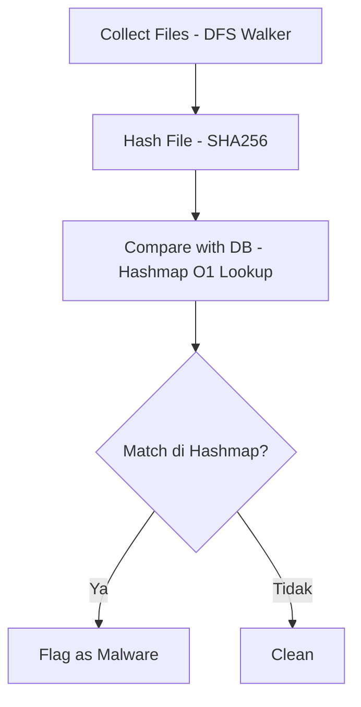

# TheRealAnnaKav (v0.1.4)

TheRealAnnaKav adalah proyek static malware scanner dan antivirus ringan yang dibangun dari nol menggunakan bahasa C untuk implementasi algoritma kriptografi SHA-256, struktur data Hashmap O(1), dan penelusuran direktori DFS, serta dilengkapi dengan antarmuka Desktop GUI berbasis Electron.js[cite: 4, 6, 8, 9, 33, 34].

---

## Arsitektur dan Fitur Utama

### 1. Mesin Inti C (`annakav.c` & `headerUndUtil/`)
* **Implementasi SHA-256 Mandiri (`sha.c` & `sha.h`)**: Menghitung digest 256-bit (`u32t sha[8]`) dari nol tanpa pustaka kriptografi eksternal[cite: 7, 8]. Mencakup pembuatan 512-bit padding (`Greg_bitLOC`), ekspansi message schedule 64-word (`wordCOME`), operasi bitwise rotasi dan sigma (`Sigma0`, `Sigma1`, `smallSig0`, `smallSig1`, `GCH`, `MAAAYOR`), serta chained block hashing (`MultiSha`) untuk menangani file berukuran kurang dari 55 byte, 55-64 byte, hingga lebih dari 64 byte[cite: 7, 8, 20].
* **O(1) Hashmap Malware Lookup (`hashmap.c`)**: Menggantikan metode Linear Comparison dengan struktur tabel hash berukuran 10 slot (`SL = 10`)[cite: 4, 7, 9]. Menggunakan fungsi index hashing `Ihash(sha) % SL` dan mekanisme Linear Probing pada `insertToHm()` serta `get()` untuk menangani tabrakan indeks (collision)[cite: 7, 9].
* **DFS Recursive Directory Walker (`util.c`)**: Menelusuri pohon direktori secara rekursif melalui fungsi `dfsWalker()`, memeriksa atribut izin eksekusi file (`S_IEXEC`, `S_IXGRP`, `S_IXOTH`), melakukan hashing pada file menggunakan `HashAfile()`, dan mencocokkannya dengan entri di dalam Hashmap[cite: 6, 22].
* **Weak File Permission Prevention (`WAFPrev` di `util.c`)**: Memvalidasi izin akses keamanan pada file kredensial sistem Linux, memastikan `/etc/passwd` mematuhi mode `0644` (group dan others tidak memiliki akses tulis) dan `/etc/shadow` mematuhi mode `0600` (hanya owner yang memiliki akses baca dan tulis)[cite: 4, 6].
* **Scan Checkpoint (`chprelated.c`)**: Mencatat dan membaca timestamp (`time_t`) pemindaian terakhir ke dalam file biner `log.bin` melalui fungsi `Checkpoint()` dan `readCheckpoint()`[cite: 10].
* **DB Signature Generator (`readwritedb.c`)**: Utilitas CLI untuk menghitung hash SHA-256 dari sebuah file sampel dan menuliskannya sebagai binary array 32-byte (`u32t HforDB[8]`) ke dalam direktori `db/`[cite: 1, 3].

### 2. Antarmuka Desktop (`Electron.js GUI`)
* **01 - DFS File Scanner**: Memilih file atau direktori target untuk dipindai, opsi penyaringan khusus file executable (`st_mode & S_IEXEC`), tombol uji cepat untuk memindai folder `db/`, tabel hasil pencocokan signature, dan panel log terminal stdout secara real-time[cite: 33, 65].
* **02 - Hashmap Table Inspector (`SL = 10`)**: Menampilkan kondisi memori `hashtable[0..9]` hasil pemanggilan `hmload()`, indeks awal `Ihash(sha) % 10`, jumlah pergeseran linear probing, serta nilai `u32t sha[8]` dalam format heksadesimal `%08x`[cite: 5, 9, 33, 65].
* **03 - DB Signature Writer**: Antarmuka grafis untuk fungsi `readwritedb.c` yang menerima input file sampel dan menyimpannya langsung sebagai file signature biner 32-byte baru di dalam folder `db/`[cite: 3, 33, 65].
* **04 - WAFPrev & Checkpoint Monitor**: Panel inspeksi status izin akses `/etc/passwd`, `/etc/shadow`, dan pembacaan waktu epoch terakhir dari file `log.bin`[cite: 4, 10, 33, 65].

---

## Alur Kerja Deteksi



---

## Struktur Direktori

```text
TheRealAnnaKav_GUI/
├── JALANKAN_GUI.bat          # Script peluncur otomatis GUI untuk Windows
├── package.json              # Konfigurasi proyek dan dependensi Electron.js
├── main.js                   # Main process Electron dan implementasi IPC backend
├── preload.js                # Context bridge IPC antara Renderer dan Main process
├── renderer/                 # Direktori frontend GUI
│   ├── index.html            # Struktur antarmuka utama (4 halaman tab)
│   ├── styles.css            # Styling antarmuka berbasis tema gelap Wasp
│   └── app.js                # Logika event handler UI dan perenderan data
├── annakav.c                 # Entry point utama program C
├── readwritedb.c             # Program C pembuat file signature biner 32-byte
├── Makefile                  # Konfigurasi kompilasi GCC
├── patch.md                  # Dokumentasi riwayat perubahan versi (v0.1.2 - v0.1.4)
├── LICENSE                   # Lisensi GNU General Public License v3.0
├── headerUndUtil/            # Modul internal mesin C
│   ├── sha.h                 # Header deklarasi tipe data, makro SHA-256, dan prototipe fungsi
│   ├── sha.c                 # Implementasi algoritma SHA-256, padding, dan MultiSha
│   ├── hashmap.c             # Implementasi struktur data Hashmap (Ihash, insertToHm, get, hmload)
│   ├── util.c                # Implementasi dfsWalker, startWalking, WAFPrev, dan LinearComparison
│   └── chprelated.c          # Implementasi Checkpoint dan readCheckpoint (log.bin)
├── db/                       # Database signature biner 32-byte
│   ├── 1.txt - 5.txt         # Sampel signature hash
│   ├── hi1.txt - hi4.txt     # Sampel signature hash tambahan
│   └── kl256.bin             # Signature biner keylogger SHA-256
└── Etherane/Anna/            # Dokumentasi teknis dan catatan arsitektur (Obsidian Vault)
    ├── AnnaKav.md
    ├── Collect Files.md
    ├── Compare with DB.md
    ├── Hash File.md
    ├── Result.md
    └── Chlara and her older sister (the sinister sister).md
```

---

## Cara Menjalankan

### 1. Menjalankan Aplikasi Desktop GUI (Electron.js)

**Menggunakan Launcher Otomatis (Windows):**
1. Ekstrak file `TheRealAnnaKav_GUI_ReadyToRun.zip`[cite: 65].
2. Buka folder `TheRealAnnaKav_GUI`[cite: 65].
3. Jalankan file `JALANKAN_GUI.bat` dengan klik dua kali[cite: 65].

**Menggunakan Terminal / Command Prompt:**
```bash
cd TheRealAnnaKav_GUI
npm config set ignore-scripts false
npm install electron@latest --foreground-scripts --save-dev
npm start
```

### 2. Mengompilasi dan Menjalankan Binary C (Linux / WSL)

Kode sumber C menggunakan header standar POSIX/Linux (`<unistd.h>`, `<dirent.h>`, `<sys/stat.h>`, `<linux/limits.h>`) dan dijalankan pada lingkungan Linux atau Windows Subsystem for Linux (WSL)[cite: 6, 7]:

**Kompilasi Program Utama (`annakav`):**
```bash
gcc headerUndUtil/chprelated.c headerUndUtil/util.c headerUndUtil/sha.c headerUndUtil/hashmap.c annakav.c -o annakav
./annakav
```

**Kompilasi Utilitas Database (`readwritedb`):**
```bash
gcc readwritedb.c headerUndUtil/sha.c -o readwritedb
./readwritedb <path_file_target> db/<nama_file_output.bin>
```

---

## Detail Teknis Implementasi

### Perhitungan Hashmap Index (`hashmap.c`)
Setiap signature di dalam folder `db/` berukuran 32 byte dan dibaca ke dalam array `u32t shafile[8]` (8 elemen bertipe `uint32_t`)[cite: 7, 9]. Indeks slot dihitung dengan fungsi berikut[cite: 9]:

```c
uint Ihash(u32t * sha){
      uint hashval = 0;
      for (int i = 0; i < 8; i++){
            hashval += (sha[i] * 3);
      }
      return hashval;
}
```

Slot awal ditentukan melalui operasi modulo `index = Ihash(sha) % SL` dengan `SL = 10`[cite: 7, 9]. Apabila slot pada indeks tersebut sudah terisi (`hashtable[index] != NULL`), algoritma akan menggeser indeks secara berurutan (`index = (index + 1) % SL`) hingga menemukan slot kosong atau mencapai batas maksimum `SL`[cite: 9].

### Penanganan Ukuran Blok SHA-256 (`sha.c`)
Fungsi `HashAfile()` membagi pembacaan file ke dalam tiga skenario ukuran[cite: 8, 20]:
1. **Ukuran <= 55 byte**: Seluruh byte input, bit `0x80`, padding nol, dan 64-bit panjang pesan (`Tot * 8`) muat dalam satu blok 64-byte tunggal dan diproses langsung oleh `sha256()`[cite: 8, 20].
2. **Ukuran 56 hingga 63 byte**: Blok 64-byte pertama diproses oleh `sha256()`, kemudian blok 64-byte kedua yang berisi panjang bit pesan diproses secara berantai oleh `MultiSha()`[cite: 8, 20].
3. **Ukuran >= 64 byte**: Blok pertama diinisialisasi menggunakan konstanta prima awal pada `sha256()`, dan setiap pembacaan 64-byte berikutnya diteruskan ke dalam loop `MultiSha()` menggunakan nilai `H[0..7]` dari iterasi sebelumnya[cite: 8, 20].

---

## Riwayat Pembaruan (Changelog)

* **v0.1.0**: Rilis awal alur dasar Hash Bit Detection (pengumpulan file, kalkulasi SHA-256, dan pencocokan database)[cite: 25].
* **v0.1.2**: Perbaikan pemanggilan fungsi perbandingan linear serta pembaruan flag pembukaan file `log.bin` menjadi `O_WRONLY | O_TRUNC | O_CREAT`[cite: 4, 36].
* **v0.1.3**: Penambahan fitur Weak File Permission Prevention (`WAFPrev`) untuk memantau dan memperbaiki izin akses file `/etc/passwd` (`0644`) dan `/etc/shadow` (`0600`)[cite: 4, 36].
* **v0.1.4**: Transisi algoritma pencarian signature dari Linear Comparison ke Hashmap Lookup (`hashmap.c`) dengan kompleksitas waktu O(1) serta integrasi antarmuka desktop berbasis Electron.js[cite: 4, 9, 33, 36].

---

## Lisensi

Proyek ini dilisensikan di bawah **GNU General Public License v3.0 (GPL-3.0)**[cite: 1, 65]. Lihat file `LICENSE` pada direktori utama untuk teks lisensi selengkapnya[cite: 1, 65].