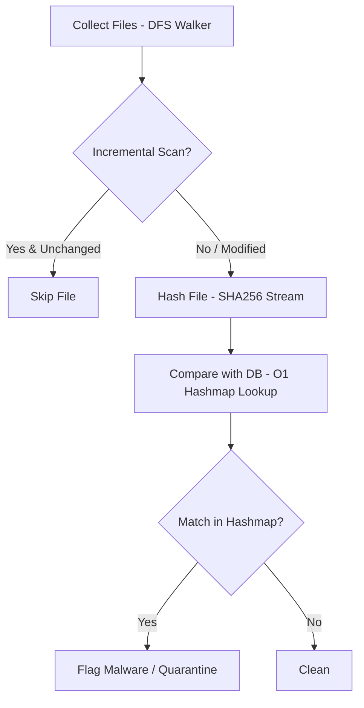

# TheRealAnnaKav (v0.1.5)

TheRealAnnaKav is a lightweight static malware scanner and antivirus built from scratch using C for the core cryptographic SHA-256 algorithm, O(1) Dynamic Hashmap data structure, and DFS directory traversal, paired with a clean Electron.js desktop GUI.

---

## Architecture and Core Features

### 1. C Core Engine (`annakav.c` & `headerUndUtil/`)
* **Custom SHA-256 Implementation (`sha.c` & `sha.h`)**: Computes 256-bit digests (`u32t sha[8]`) from scratch without external cryptographic libraries. Features a streaming `shaFromFd()` pipeline using 64-byte block reading (`readFull()`), exact standard padding (`0x80` and 64-bit length) across arbitrary file sizes, bitwise compression operations (`Sigma0`, `Sigma1`, `smallSig0`, `smallSig1`, `GCH`, `MAAAYOR`), and chained block compression (`MultiSha`).
* **Dynamic Hashmap O(1) Malware Lookup (`hashmap.c`)**: Dynamic hash table allocation starting with 16 slots (`SL = 16`) that automatically rehashes and resizes by 2x once the load factor reaches 70%. Employs index hashing `Ihash(sha) % hmCapacity` and linear probing in `insertToHm()` and `get()`.
* **DFS Recursive Directory Walker & Incremental Scan (`util.c`)**: Traverses directory trees recursively via `dfsWalker()`, verifies execution permissions (`S_IEXEC`, `S_IXGRP`, `S_IXOTH`), and supports Incremental Scanning to skip files unmodified since the previous run (`file.st_mtime > readCheckpoint()`).
* **Quarantine Vault (`util.c`)**: Isolates detected malware files into the `quarantine/` directory and revokes execution permissions (`chmod 0000`).
* **Weak File Permission Prevention (`WAFPrev` in `util.c`)**: Validates access permissions on Linux credential files, ensuring `/etc/passwd` adheres to `0644` and `/etc/shadow` complies with `0600`.
* **Scan Checkpoint (`chprelated.c`)**: Records and retrieves the last scan timestamp (`time_t`) to/from binary `log.bin` using dynamic path resolution via `annaInitPaths()` without hardcoded machine paths.
* **DB Signature Generator (`readwritedb.c`)**: CLI utility to hash a target sample file and save its 32-byte binary digest (`u32t HforDB[8]`) directly into `db/`.

### 2. Desktop Interface (`Electron.js GUI`)
* **01 - Scanner**: Select target files or directories, toggle executable-only filtering (`S_IEXEC`), toggle Incremental Checkpoint skipping, run quick scans on the `db/` folder, view matched results in a structured table, and inspect real-time log output.
* **02 - Hashmap**: Displays dynamic hashmap slots (`hashtable`), memory capacity, initial hash index `Ihash(sha) % cap`, probe counts, and formatted `u32t sha[8]` hex values.
* **03 - Signature Writer**: Graphical frontend for `readwritedb.c` to generate and write 32-byte binary signatures directly into `db/`.
* **04 - Quarantine**: Centralized management panel for files isolated in `quarantine/`, providing Restore to original path or permanent Delete actions.
* **05 - System Check**: Inspects permission compliance for `/etc/passwd` and `/etc/shadow`, alongside reading the last epoch timestamp from `log.bin`.

---

## Detection Workflow



---

## Directory Structure

```text
TheRealAnnaKav_GUI/
├── JALANKAN_GUI.bat          # Automated GUI launcher script for Windows
├── package.json              # Project configuration and Electron dependencies
├── main.js                   # Electron main process, O(1) hmGet, and quarantine manager
├── preload.js                # IPC context bridge between Renderer and Main process
├── renderer/                 # Frontend GUI directory (neutral, minimal design)
│   ├── index.html            # Main markup (5-tab navigation)
│   ├── styles.css            # Dark neutral styling
│   └── app.js                # UI event handling and XSS sanitization
├── annakav.c                 # Primary C program entry point
├── readwritedb.c             # C utility for writing 32-byte signature binaries
├── Makefile                  # GCC compilation configuration
├── patch.md                  # Version patch notes and release logs (v0.1.2 - v0.1.5)
├── LICENSE                   # GNU General Public License v3.0
├── headerUndUtil/            # Internal C engine modules
│   ├── sha.h                 # Data types, function prototypes, and SHA-256 macros
│   ├── sha.c                 # Streaming SHA-256 and standard padding implementation
│   ├── hashmap.c             # Dynamic Hashmap implementation (2x auto-resize)
│   ├── util.c                # Implementations of dfsWalker, WAFPrev, and quarantineFile
│   └── chprelated.c          # Checkpoint logging and dynamic path resolution
├── db/                       # 32-byte binary signature database
│   ├── 1.txt - 5.txt         # Sample signature hashes
│   ├── hi1.txt - hi4.txt     # Additional sample signature hashes
│   └── kl256.bin             # Keylogger binary SHA-256 signature
├── quarantine/               # Directory for isolated files (created automatically)
└── Etherane/Anna/            # Technical documentation and notes (Obsidian Vault)
```

---

## Getting Started

### 1. Running Desktop GUI (Electron.js)

**Using Automated Launcher (Windows):**
1. Open the `TheRealAnnaKav_GUI` folder.
2. Double-click `JALANKAN_GUI.bat`.

**Using Command Prompt / Terminal:**
```bash
cd TheRealAnnaKav_GUI
npm install
npm start
```

### 2. Compiling and Running C Binaries (Linux / WSL)

The C source code follows POSIX/Linux standards (`<unistd.h>`, `<dirent.h>`, `<sys/stat.h>`) and can be built in a Linux or WSL environment:

**Build Main Program (`annakav`):**
```bash
make
./annakav
```
*(Or compile manually)*:
```bash
gcc headerUndUtil/chprelated.c headerUndUtil/util.c headerUndUtil/sha.c headerUndUtil/hashmap.c annakav.c -o annakav
./annakav
```

**Build Database Signature Utility (`readwritedb`):**
```bash
gcc readwritedb.c headerUndUtil/sha.c headerUndUtil/chprelated.c -o readwritedb
./readwritedb <target_file_path> db/<output_name.bin>
```

---

## Technical Implementation Details

### Dynamic Hashmap & Hash Indexing (`hashmap.c`)
Each 32-byte binary signature is read into an 8-element `uint32_t` array (`u32t sha[8]`). Slot indices are calculated using:

```c
uint Ihash(u32t * sha){
      uint hashval = 0;
      for (int i = 0; i < 8; i++){
            hashval += (sha[i] * 3);
      }
      return hashval;
}
```

The initial slot is computed as `index = Ihash(sha) % hmCapacity`. When collisions occur, the algorithm advances sequentially using linear probing. Once the occupied slots reach $\ge 70\%$, the capacity doubles (2x) and all entries are rehashed into the expanded table.

### Streaming SHA-256 Pipeline (`sha.c`)
The `shaFromFd()` function processes input data incrementally in 64-byte chunks via `readFull()`. At the end of the stream, standard padding (`0x80`, zero bytes, and 64-bit big-endian length) is appended (1 block if remaining bytes $\le 55$, or 2 blocks if remaining bytes are $56..63$), guaranteeing digest parity with standard SHA-256 implementations.

---

## Changelog

* **v0.1.0**: Initial baseline release for Hash Bit Detection workflow (file discovery, SHA-256 calculation, and database comparison).
* **v0.1.2**: Fixed linear comparison routine and updated `log.bin` file mode flags to `O_WRONLY | O_TRUNC | O_CREAT`.
* **v0.1.3**: Added Weak File Permission Prevention (`WAFPrev`) to audit and fix `/etc/passwd` (`0644`) and `/etc/shadow` (`0600`) access permissions.
* **v0.1.4**: Migrated signature lookup from Linear Comparison to Hashmap Lookup (`hashmap.c`) with O(1) complexity and introduced the Electron.js desktop interface.
* **v0.1.5**: Implemented Dynamic Hashmap (auto-resize 2x), Incremental Checkpoint scanning, Quarantine Vault (isolation, restore, and deletion), stream-based file hashing, C/Electron security hardening, and a refined minimal GUI layout.

---

## License

This project is licensed under the **GNU General Public License v3.0 (GPL-3.0)**. Refer to the `LICENSE` file in the root directory for the complete license terms.
